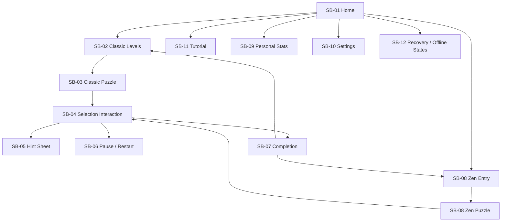

# SHIKAKU — Mobile-First Visual and Interaction Storyboard

**Document version:** 1.3  
**Status:** Finalized design specification for implementation; wireframes are schematic, not final artwork  
**Primary target:** 320–430 px portrait mobile browsers  
**Secondary:** 768 px tablet; desktop design occurs **last**  
**Related document:** [`prd.md`](./prd.md)  
**Visual approach:** Minimal Japanese-inspired UI, pastel region colors, CSS-drawn board, very small SVG icons  
**Backend:** None; all progress is local to IndexedDB

---

## 1. Design brief and nonnegotiables

### 1.1 Desired feeling

**Quiet, tactile, precise, gently rewarding.** The board is the hero. A player should understand what to touch, easily see the rectangles they have made, and never feel rushed in Zen. Classic can track personal best times without looking like a racing interface.

### 1.2 Screen design rules

1. **Mobile first:** Design and screenshot-validate at 320, 360, 390, and 430 px before adapting to tablet/desktop.
2. **No accounts, leaderboard, ranks, global scores, chat, or network interface.** Home and Results show only local progression and personal records.
3. **No big SVGs:** Game board is HTML + CSS Grid; rectangles use CSS fills/borders. SVG only for sparse icons with simple paths; ideally <1 KB per icon and <3 KB per small decorative graphic.
4. **No image-heavy pages:** System fonts, soft CSS backgrounds, no video, no 3D, no large raster image downloads, no icon library.
5. **Always playable:** Decorative animation must not block pointer input. A user can switch it off.
6. **No install:** The game runs by opening a static HTTPS link; optional home-screen shortcut is not a prerequisite.
7. **Restore safely:** Back, reload, interruption, backgrounding, and offline return preserve committed puzzle progress when local storage is available.
8. **Accessibility:** High readability, visible focus, non-color indicators, screen-reader messages, keyboard controls, and two-tap selection.

### 1.3 Canonical modes

| Attribute | Classic | Zen |
|---|---|---|
| Primary purpose | Solve fixed curated levels, improve own records | Solve endlessly without pressure |
| Levels | Fixed IDs, sequential unlock within each tier | Generated unique puzzles plus verified fallbacks |
| Timer | Visible active-play timer | Never visible |
| Progress | Completed level count, personal best | Locally tracked completions only |
| Hints | Allowed, counted | Unlimited, without penalty |
| Rank/leaderboard | **None** | **None** |
| Backend/network | **None** | **None** |

---

## 2. Design tokens and visual system

### 2.1 Brand

**Wordmark:** `SHIKAKU.` in bold, letterspaced, near-black text. Avoid an external brand logo asset; render as text to reduce bytes. Subtext: `A quiet little puzzle.` or `Make space. Find shapes.` English initially; structure strings for later translation.

### 2.2 Base colors

Use the following colors as initial design tokens; tune contrast as part of accessibility QA (especially text on tinted backgrounds).

| Token | Light theme | Usage |
|---|---|---|
| `--canvas` | `#F7F7F2` | Main background, warm off-white |
| `--surface` | `#FFFFFF` | Cards/sheets |
| `--ink` | `#25333A` | Primary text, clue numerals |
| `--muted` | `#67767B` | Secondary text |
| `--grid-line` | `#B9C8C9` | Light cell borders |
| `--region-outline` | `#526B70` | Clear rectangle boundaries |
| `--mint` | `#CDE9DE` | Region color 1 |
| `--sky` | `#CDDFF5` | Region color 2 |
| `--lilac` | `#E5DDF4` | Region color 3 |
| `--peach` | `#F9E2B9` | Region color 4 |
| `--rose` | `#F4D4DA` | Region color 5 |
| `--selected-stroke` | `#256B68` | Selected region border |
| `--error-stroke` | `#A23D50` | Invalid preview outline |

A 5-color sequence may repeat across puzzle regions, but adjacent regions should preferably be assigned different colors. Since fill colors are decorative, **every region must also have a distinguishable outline**. Contrast-check all text/button combinations; do not force small muted text over low-contrast backgrounds.

Dark theme uses deep navy/charcoal surfaces (`#152227` / `#1E2E34`) and muted, high-contrast versions of the region colors. Do not simply invert the page.

### 2.3 Typography

- Use `system-ui, -apple-system, BlinkMacSystemFont, "Segoe UI", sans-serif`.
- Wordmark: ~28–36 CSS px mobile, weight 700–800.
- Screen heading: 22–26 px / weight 650.
- Normal UI labels: 14–16 px; avoid important text under 14 px.
- Clues: fluid with cell size; aim 16–22 px for ordinary boards, maintaining readability in zoomed large boards.
- Timer: tabular numerals, 14–16 px.
- Buttons: 15–16 px, medium weight; do not load custom font families.

### 2.4 Spacing / geometry

- Use a 4 px spacing base; common spacing: 8 / 12 / 16 / 24 / 32 px.
- Mobile horizontal gutter: 16 px (may reduce to 12 px at 320 px).
- Standard card radius: 16–20 px. Small controls: 10–12 px.
- Toolbar controls: **minimum 44×44 px hit zone**, regardless of drawn icon size.
- Board max width: available viewport width minus gutters. Enforce 1:1 board-cell aspect ratio; non-square boards still have square *cells* and an appropriate rectangular board outline.
- Bottom controls account for `env(safe-area-inset-bottom)`.
- Use shadows sparingly; a subtle elevation on bottom sheets is sufficient.

### 2.5 Icons and asset budgets

All icons are simple strokes: Back, Settings, Play, Leaf, Clock, Undo, Redo, Hint, Restart, Pause, Close, Check, Download, Upload, Zoom In, Zoom Out, and Pan. Use tiny inline SVG paths or CSS primitives. Do **not** include giant sprite libraries, raster icon sets, embedded SVG filters, text converted to paths, or illustrative background SVGs. Suggested targets: ~16–20 icons, each ideally below 1 KB uncompressed.

**Illustrations:** avoid them for Phase 0. If desired later, use one tiny CSS rectangle motif. **Puzzle regions:** CSS, not vector artwork.

---

## 3. User journey and scene map



The storyboard separates **screens** from **interaction states**. `SB-04` (drag/two-tap placement) occurs inside both Classic and Zen boards and is not a standalone route. `SB-05` and `SB-06` are overlays/sheets, not new pages.

### Initial navigation decisions

- Start at Home unless user explicitly opened a valid game URL.
- Show a `Continue` card on Home if IndexedDB contains a resumable session.
- If game progress exists, completing a level presents `Next level`, `Replay`, and `Home`.
- Use a consistent Back button at the top-left of secondary screens.
- Do not put a persistent bottom navigation bar on the game screen; leave space for the board and its actions.
- When moving away from a game, autosave first. Classic timer pauses when game is no longer active.

---

## 4. Mobile frame anatomy and responsive behavior

### 4.1 Reference viewport and vertical order

Primary design: **390×844 px**, including phone browser chrome differences accounted for with dynamic viewport units. Compact pass: 320×568. The page must work when available viewport height shrinks for browser toolbar changes.

Game screen vertical order:

1. Safe-area top + slim status/header row.
2. Level/mode heading + Classic timer and progress OR Zen calming subtitle.
3. Flexible whitespace (small).
4. Centered game board (largest element).
5. Context message row (errors/help, 1–2 lines).
6. Undo / Redo / Hint / Restart toolbar.
7. Optional Zoom/Pan controls for larger grids.
8. Bottom safe-area breathing room.

**Constraint:** The board must never force primary buttons outside the visible viewport with no way to scroll. On short screens, let the outer content scroll naturally when no drag is active; keep buttons accessible rather than cropping them.

### 4.2 Board layout formula

For a square `n×n` board in fit mode:

`availableBoardWidth = min(viewportWidth − 2×gutter, availableLayoutWidth)`  
`cellSize = availableBoardWidth / n`

For 12×12 on a 320 px screen with 12 px gutters, a fitted cell is about 24.7 CSS px, which is too small for precise direct targeting. Therefore large boards support explicit zoom, pan, and two-tap corner selection. The UI must not advertise all cells as 44 px targets in fit mode; only primary controls maintain that hit-box minimum.

### 4.3 Breakpoints

| Width | Layout strategy | Priority |
|---|---|---|
| `320–359 px` | Compact gutters, condensed header, wrap toolbars if necessary | P0 |
| `360–430 px` | Default phone portrait, full-width board | P0 |
| `431–767 px` | Comfortable phone/large portrait | P0 |
| `768–1023 px` | Centered board with contextual panel where room allows | P6 |
| `1024 px+` | Board plus optional right utility rail and generous whitespace | P6 |

Never introduce desktop-only interaction requirements. Mouse hover is enhancement, not the only way to discover controls.

---

# 5. Detailed storyboard scenes

## SB-01 — Home / Welcome

**Route:** `#/`  
**Phase:** P0  
**Player goal:** Start a puzzle in one or two intentional taps, or resume immediately.

### Mobile wireframe

```text
┌─────────────────────────────────┐
│                           ⚙     │
│                                 │
│          SHIKAKU.               │
│       A quiet little puzzle     │
│                                 │
│    ┌───────────────────────┐    │
│    │ Continue              │    │  ← conditional
│    │ Classic · Level 08    │    │
│    └───────────────────────┘    │
│                                 │
│    ┌───────────────────────┐    │
│    │ ▦  CLASSIC            │    │
│    │ Levels & personal best│    │
│    │                 →     │    │
│    └───────────────────────┘    │
│    ┌───────────────────────┐    │
│    │ ◌  ZEN                │    │
│    │ Play without a clock  │    │
│    │                 →     │    │
│    └───────────────────────┘    │
│                                 │
│   How to Play      My Progress  │
│                                 │
└─────────────────────────────────┘
```

### Specification

- Header contains only a Settings icon in upper-right; brand wordmark is centered and prominent.
- Optional Continue card appears **above** the mode cards only if an incomplete game exists.
- Classic and Zen cards have title, one-line description, recognizable geometric icon, and visible chevron.
- Footer has `How to Play` and `My Progress`; no Login, Leaderboard, Register, Online, or Friends controls.
- A first-time user can select Classic and reach a level in ≤3 taps.

### Motion / feedback

- On entering Home: wordmark fades in over 250 ms, then mode cards settle in with a subtle 30 ms stagger.
- On tap: card scale goes to 0.985 for ~100 ms; do not use strong spring bounce.
- On Return: preserve last-scroll position if possible, but Home should normally fit without long scrolling.

### Variants / checks

- **Fresh user:** no Continue card, mode cards centered more generously.
- **Returning user:** Continue card shows the mode, level/board size, and last saved date.
- **Save not available:** top banner states “Progress cannot be saved on this browser.”
- **320 px:** all labels wrap gracefully; no card text clipping.

**Screenshot IDs:** `M01-home-fresh`, `M02-home-continue`, `M03-home-storage-warning`.

---

## SB-02 — Classic level selection

**Route:** `#/classic`  
**Phase:** P0 + P2  
**Player goal:** Choose a level, understand completion status, and replay completed levels.

### Mobile wireframe

```text
┌─────────────────────────────────┐
│  ←         CLASSIC           ⚙  │
│  Solve at your own pace         │
│                                 │
│  Beginner  Easy  Medium  Hard  › │
│  ───────                        │
│                                 │
│  BEGINNER · 5×5                 │
│  Completed: 4 / 10              │
│  ███████░░░░░░░░                │
│                                 │
│  ┌──────┐ ┌──────┐ ┌──────┐     │
│  │ 01 ✓ │ │ 02 ✓ │ │ 03 ✓ │     │
│  └──────┘ └──────┘ └──────┘     │
│  ┌──────┐ ┌──────┐ ┌──────┐     │
│  │ 04 ✓ │ │ 05 → │ │ 06 🔒│     │
│  └──────┘ └──────┘ └──────┘     │
│  ┌──────┐ ┌──────┐ ┌──────┐     │
│  │ 07 🔒│ │ 08 🔒│ │ 09 🔒│     │
│  └──────┘ └──────┘ └──────┘     │
│                                 │
│  Tap a completed level to replay│
└─────────────────────────────────┘
```

### Specification

- Scrollable category chips: Beginner / Easy / Medium / Hard / Expert, with readable selected state. Horizontal chip scroll never scrolls the **whole page** sideways.
- Category label, grid dimension, completed fraction, compact progress bar.
- Grid of 3 level tiles on typical phones; permit 2 if accessibility font scaling makes 3 unusable.
- Tile states: `completed` (check and optional best time detail), `next` (strong outline), `locked` (lock icon), and `active session` (small resume marker).
- Opening a completed tile offers a fresh replay; opening an active tile resumes.
- First level in each difficulty is unlocked from the beginning; remaining levels unlock sequentially within that category.
- Avoid fake stars/rankings or server scoring.

### Motion / feedback

- Switching difficulty chips changes content with ~150 ms opacity transition, not a full-screen slide.
- Completed tile has a small checkmark pulse once at completion; normal browsing is static.
- Locked tile tap gives informative text: “Finish Level 05 to unlock.”

### Variants / checks

- Long best times display without overflow (`1:02:36`).
- Empty category (content not shipped): hide or disabled with honest label; no fake levels.
- Test 320 px, large text, category chips scrolling, and focus order.

**Screenshot IDs:** `M04-classic-levels`, `M05-levels-locked`, `M06-levels-replay`.

---

## SB-03 — Classic game board (idle)

**Route:** `#/play/classic/:levelId`  
**Phase:** P0 + P1 + P2  
**Player goal:** Focus on the puzzle; access tools without obscuring the board.

### Mobile wireframe

```text
┌─────────────────────────────────┐
│  ←          LEVEL 08         ⋯  │
│  CLASSIC · 5×5                  │
│  02:14               60% filled │
│  ━━━━━━━━━━━━━━━──────────────  │
│                                 │
│       ┌───┬───┬───┬───┬───┐     │
│       │   │ 3 │   │   │   │     │
│       ├───┼───┼───┼───┼───┤     │
│       │ 2 │   │   │   │ 6 │     │
│       ├───┼───┼───┼───┼───┤     │
│       │   │   │   │   │   │     │
│       ├───┼───┼───┼───┼───┤     │
│       │   │ 4 │   │   │   │     │
│       ├───┼───┼───┼───┼───┤     │
│       │   │   │   │ 3 │   │     │
│       └───┴───┴───┴───┴───┘     │
│                                 │
│  Draw rectangles around numbers │
│                                 │
│   [↶]     [↷]    [Hint]   [⟳]  │
│                                 │
└─────────────────────────────────┘
```

**Wireframe clues are illustrative only**; production fixtures must be solver-verified and the visual QA screenshots must use the actual puzzle definitions.

### Specification

- Board is largest single element. No permanent leaderboard rail, ad rail, chat, or other distractions.
- Minimal header: Back, `Level XX`, overflow menu for Pause/How to Play/Settings.
- Classic mode metadata: `Classic · grid size`, active timer, percent of **covered cells**.
- Board is centrally aligned. Use real CSS Grid cells and separately positioned rectangle region layers.
- Clues are high-contrast numerals centered in cells; clues remain visible above translucent fills.
- A single contextual tip row sits below board and changes to validation feedback/hints.
- Toolbar order: Undo, Redo, Hint, Restart; actions remain present but disabled with explanation when unavailable.
- Pause via overflow or a compact dedicated button if space allows. On backgrounding Classic automatically pauses; returning displays Resume state.

### Board layering (back to front)

1. Background/cell grid lines (CSS).
2. Committed rectangle fills (CSS backgrounds with stable assigned palette).
3. Rectangle boundary strokes (visible 2 px outlines or equivalent).
4. Cell clue text (above fills).
5. Gesture preview/selection border (topmost, pointer-events disabled).
6. Focus outline (visible for keyboard).

### Accessibility / QA

- Screen reader announces current cell position and clue (if any).
- Zoom and pan states announced when activated.
- Percentage derived from committed cell area, not number of clues completed.
- Timer not updated through a noisy live region every second.
- Cell layout and toolbar must remain visible/useful at 320×568.

**Screenshot IDs:** `M07-classic-board-empty`, `M08-classic-board-partial`, `M09-classic-board-paused`.

---

## SB-04 — Selection, preview, validation, and editing

**Context:** Inside either gameplay mode  
**Phase:** P1  
**Player goal:** Draw accurate rectangles with mouse, touch, or keyboard.

### Interaction frames

```text
A. IDLE          B. DRAWING          C. VALID           D. INVALID

┌─┬─┬─┐          ┌─┬─┬─┐             ┌─────┬─┐          ┌─┬─┬─┐
│ │3│ │          │ ·····│            │  3  │ │          │╳│3│ │
├─┼─┼─┤    →     │ :3 :│      →     └─────┼─┤          ├─┼─┼─┤
│ │ │ │          ├─┼─┼─┤             │     │ │          │ │ │ │
└─┴─┴─┘          │ │ │ │             └─────┴─┘          └─┴─┴─┘
                  translucent           soft fill         outline + text
```

### Step-by-step touch sequence

1. **Pointer down** on a cell: set anchor and show a subtle corner marker; record pointer ID.
2. **Pointer move** across cells: compute inclusive rectangle from anchor to current cell. Show tinted preview and dimensions `2 × 3 = 6` in a compact floating pill if legible.
3. **Pointer up**: validate. If valid, commit once and animate the fill/border into place. If invalid, briefly indicate failure, announce reason, and retain previous board unchanged.
4. **Pointer cancel/lost capture**: clear the transient preview without saving anything.
5. **Tap, then tap:** first tap anchors; second tap selects opposite corner and follows exactly the same validation path.
6. **Tap committed region:** select; contextual `Change` and `Remove` appear. Change enters anchored redraw mode linked to that clue; success atomically replaces the selected region.

### Important conflict handling

- When a drag is clearly detected, do not also interpret it as two taps.
- Scrolling outside the board works normally. Inside the board, capture pointer gestures only while drawing; pan works under explicit Pan mode when zoomed.
- A tap on an existing region selects it rather than silently overwriting it.
- Invalid placement must not change undo history or the filled-percentage display.
- Area-correct rectangles may still cause a future dead end; the basic validator does not compare them to the hidden canonical answer.
- Rapid double taps or duplicate `pointerup` events cannot create two actions.

### States and visual language

| State | Visual treatment | Message |
|---|---|---|
| Anchor set | Single highlighted starting cell and corner dot | “Select the opposite corner” |
| Preview locally valid | Mint/sky translucent fill, 2 px solid outline | “2 × 3 = 6” |
| Preview locally invalid | Lightly tinted fill, dashed/error boundary | “Area must equal 6” or specific cause |
| Committed | Pastel solid region fill + strong boundary | Optional soft confirmation pulse |
| Region selected | Darker outline and actions below board | “Change · Remove” |
| Contradiction detected by Check/Hint | Indicate related region, not all-red board | “These choices leave no complete solution” |

### Motion

- Preview follows move without animation lag; do not animate each sampled pointer coordinate.
- Successful commit: opacity/scale settle ~180 ms.
- Invalid: border pulses once ~160 ms; **no screen shake**.
- Region removal: quick fade ~130 ms.
- With reduced motion: immediate state changes, readable message remains.

**Screenshot IDs:** `M10-anchor`, `M11-drag-valid-preview`, `M12-drag-invalid-preview`, `M13-region-selected`, `M14-zoomed-board`.

---

## SB-05 — Hints and contradiction guidance

**Context:** Bottom sheet on the game screen  
**Phase:** P3  
**Player goal:** Get unstuck without losing trust in the puzzle rules.

### Mobile wireframe

```text
┌─────────────────────────────────┐
│      Puzzle dimmed behind       │
│                                 │
│  ┌───────────────────────────┐  │
│  │            ━              │  │
│  │ HINT                      │  │
│  │                           │  │
│  │ Look at the 6 near the    │  │
│  │ right edge.               │  │
│  │                           │  │
│  │ [Nudge] [Explain] [Reveal]│  │
│  │                           │  │
│  │               Close       │  │
│  └───────────────────────────┘  │
└─────────────────────────────────┘
```

### Specification

- First tap Hint opens a bottom sheet with choices `Nudge`, `Explain`, `Reveal`.
- `Nudge`: highlight one relevant clue/region, short explanation, no board edit.
- `Explain`: show why one or more orientations cannot work. Keep explanation human-readable (e.g., “A 1×6 rectangle would include another number”).
- `Reveal`: commit one confirmed correct rectangle only if current board has a compatible solution; count hint usage.
- If current regions are contradictory, do **not** reveal a clashing solution. Explain that a previous rectangle must change; offer `Review last move` or close.
- For unsolved generator/solver timeout, show “Hint is unavailable for this position. Try undoing a move.” No fake logical claim.
- Sheet is keyboard escapable; focus returns to Hint button on close.

### Motion / screenshots

Dim board with very light scrim; sheet moves up ~240 ms, no bounce. Reduced-motion uses no travel animation.

**Screenshot IDs:** `M15-hint-sheet`, `M16-hint-contradiction`, `M17-hint-unavailable`.

---

## SB-06 — Pause, restart, and navigation safety

**Context:** Game screen overlay  
**Phase:** P1 + P2  
**Player goal:** Interrupt play safely and return later.

### Specification

- Classic: Pause sheet with `Resume`, `Restart puzzle`, `How to Play`, `Save and Exit`.
- Zen: replace Pause with a softer `Game Options` sheet; no timer or score language.
- `Save and Exit` saves the current committed board and navigates Home.
- `Restart puzzle` always asks confirmation if committed moves exist. Restart creates a fresh board state for that puzzle while preserving old completed results.
- Closing/backing out of a partially finished game does not ask “Discard?” unless a destructive operation is requested—autosave is expected.
- Classic automatically pauses on tab backgrounding; reload returns paused with clearly visible Resume.
- If save fails, state remains in memory, a warning appears, and the user can still cancel navigation or continue temporary play.

### Motion / feedback

Overlay enters in ~200 ms. Pressing Resume returns to the exact board position/zoom level when practical. Do not let hidden/paused screens increment Classic time.

**Screenshot IDs:** `M18-classic-pause`, `M19-restart-confirm`, `M20-save-failed`.

---

## SB-07 — Puzzle completion / personal best

**Context:** Result bottom sheet or modal after valid full coverage  
**Phase:** P1 + P2  
**Player goal:** Feel rewarded, understand what was completed, and choose what to do next.

### Mobile wireframe

```text
┌─────────────────────────────────┐
│                                 │
│       ▦ COMPLETED!              │
│                                 │
│       Level 08 · Classic        │
│                                 │
│       03:42                     │
│       Your best: 03:42          │
│       Hints used: 0             │
│                                 │
│   ┌─────────────────────────┐   │
│   │       NEXT LEVEL →      │   │
│   └─────────────────────────┘   │
│       Replay      Home          │
│                                 │
└─────────────────────────────────┘
```

### Specification

- After full coverage, lock board; start a small sequential region-highlight celebration (~600 ms total).
- Result sheet announces `Completed!`, mode, puzzle ID/level, Classic time (if Classic), personal best if achieved, hints used, and primary next action.
- **Zen version:** no elapsed time, no “best time”, no performance score, no rank; simply `Another Puzzle`, `Home`, and optional completion count.
- On Classic, `Next Level` only appears if a valid next curated level exists and is unlocked; otherwise offer `Level Select` as primary.
- Replay always starts a clean attempt while retaining personal records.
- Ensure duplicate completion events do not create duplicate results.
- No confetti library or large SVG particle effect. Use CSS highlights and optionally a handful of tiny geometric shapes; honor reduced motion.

### Screenshot IDs

`M21-complete-classic`, `M22-complete-new-best`, `M23-complete-zen`, `M24-complete-last-level`.

---

## SB-08 — Zen selection and Zen puzzle

**Routes:** `#/zen`, `#/play/zen/:sessionId`  
**Phases:** P0 + P2 + P4  
**Player goal:** Begin a calm session with almost no configuration.

### Zen entry wireframe

```text
┌─────────────────────────────────┐
│  ←            ZEN               │
│                                 │
│       Take your time.           │
│       Just find the shapes.     │
│                                 │
│       Grid size                 │
│       [5×5] [6×6] [7×7]         │
│       [10×10] [12×12]           │
│                                 │
│   ┌─────────────────────────┐   │
│   │     NEW PUZZLE  →       │   │
│   └─────────────────────────┘   │
│                                 │
│   Continue previous puzzle      │
│                                 │
└─────────────────────────────────┘
```

### Specification

- Zen opens with optional `Continue previous puzzle` and a size/difficulty selector.
- Default board size on first visit: **5×5**, to maintain approachable phone interactions.
- `New Puzzle` requests generated unique puzzle from Web Worker. Show unobtrusive loading feedback with `Cancel` if generation is slow.
- If generation fails or times out, load a verified curated fallback and label it honestly.
- Zen gameplay reuses **the exact same PuzzleBoard, validation, undo/redo, and hint components** as Classic.
- Zen HUD shows a gentle `Zen · 5×5` label and progress, **never a timer**.
- Avoid forced streaks, countdowns, rankings, challenge prompts, or celebratory score comparison.
- Ambient visual effect should be optional, nearly static, and CSS-only (e.g. slow, low-opacity gradient shift).

### Screenshot IDs

`M25-zen-entry`, `M26-zen-board`, `M27-zen-generating`, `M28-zen-fallback`.

---

## SB-09 — Personal progress / statistics

**Route:** `#/stats`  
**Phase:** P2  
**Player goal:** Review one's own history without competitive pressure.

### Mobile wireframe

```text
┌─────────────────────────────────┐
│  ←        MY PROGRESS           │
│                                 │
│  CLASSIC                        │
│  ┌──────────┐ ┌─────────────┐   │
│  │  12 / 30 │ │ Best 01:08  │   │
│  │ levels   │ │ on Level 03 │   │
│  └──────────┘ └─────────────┘   │
│                                 │
│  By difficulty                 │
│  Beginner  ████████░░           │
│  Easy      ████░░░░░░           │
│                                 │
│  ZEN                            │
│  Puzzles completed: 07         │
│                                 │
│  Recent completions             │
│  Level 08 · 03:42 · Oct 24      │
│  Level 07 · 04:10 · Oct 23      │
└─────────────────────────────────┘
```

### Specification

- Only IndexedDB data appears; stats belong to the current browser/device.
- Classic: completed distinct levels, percent by category, personal best per level, no-hint personal best when available.
- Zen: completed count and optionally recently solved puzzle sizes; no time ranking.
- First-time empty state: “Complete your first puzzle to see your progress” and `Play Classic` button.
- Provide concise local-only explanation near the footer: “Saved on this device. Export a backup in Settings.”
- Do not add share links, cloud sync promises, leaderboard cards, or player accounts.

### Screenshot IDs

`M29-stats-populated`, `M30-stats-empty`.

---

## SB-10 — Settings, accessibility, and backup

**Route:** `#/settings`  
**Phases:** P0 + P2 + P5  
**Player goal:** Adjust comfort, protect local progress, and understand offline limits.

### Content order

1. **Appearance:** Light / Dark / System.
2. **Motion:** Reduced motion toggle, defaults to OS preference.
3. **Feedback:** Sound toggle (off by default), haptic feedback toggle only where supported.
4. **Gameplay:** Default selection style (Drag + Two Tap always supported; user can prefer Two Tap), high-contrast board outlines toggle.
5. **Local data:** Export Save (JSON), Import Save (JSON), storage status and explanation.
6. **About:** version, offline behavior, privacy note, reset progress.

### Interactions

- Toggles save immediately if storage works; show saved confirmation discreetly.
- Export produces a downloadable JSON file without server involvement.
- Import validates file and previews import actions before applying; corrupted/unsupported backup produces a safe error.
- `Reset progress` is **destructive**, requires explicit multi-step confirmation, and must not be placed near ordinary toggles.
- Do not expose technical SQL terms, tokens, or D1 configuration; none exists.

### Screenshot IDs

`M31-settings`, `M32-import-preview`, `M33-reset-confirm`.

---

## SB-11 — Guided How to Play

**Route:** `#/how-to-play`; also available as optional contextual overlay  
**Phase:** P1  
**Player goal:** Understand the rules without reading a wall of text.

### Teaching sequence (using verified 4×4 fixture in PRD)

| Beat | Visual action | Text |
|---|---|---|
| T1 | Show 4×4 board with clues | “Every number belongs to one rectangle.” |
| T2 | Highlight clue 4 at row 0/col 1 | “A rectangle around 4 covers exactly 4 cells.” |
| T3 | Animate/tutorial-guide a one-row, four-cell drag | “Drag, or tap two corners, to select a rectangle.” |
| T4 | Fill that region | “Rectangles cannot overlap or include another number.” |
| T5 | Invite player to complete remaining regions | “Cover the whole board to finish.” |
| T6 | Completion message | “You're ready. Choose a puzzle.” |

The tutorial uses the exact unique solution documented in `prd.md`. It should support skipping, replaying, and keyboard controls. No voice-over file required. The player should not be forced to learn advanced hint/undo features before starting Classic.

### Screenshot IDs

`M34-tutorial-step-1`, `M35-tutorial-draw`, `M36-tutorial-complete`.

---

## SB-12 — Offline, storage failure, and recovery

**Context:** Non-happy-path overlays and banners  
**Phases:** P2 + P5  
**Player goal:** Know whether the current game is saved and recover where possible.

### State matrix

| Trigger | User-facing text | Action |
|---|---|---|
| First visit with no internet | Browser cannot load uncached website | No false offline guarantee; require a successful initial online visit |
| Repeat visit offline after successful cache | “Playing offline” (optional subtle badge) | Continue local games normally |
| IndexedDB not available | “Local saving is unavailable. You can play temporarily.” | Continue in memory; offer export when possible |
| Save transaction fails | “This move is not saved yet.” | Retry, export current state, or continue in memory |
| Saved session corrupted | “We couldn't restore that session.” | Preserve raw backup if recoverable; offer another puzzle |
| Generator timed out | “Opening a ready-made puzzle instead.” | Load verified fallback |
| Cache updating | No blocking prompt unless needed | Finish installing next cache version safely |
| Two tabs edit same game | “This puzzle is open in another tab.” | Choose reload current save or separate session |
| Invalid backup import | “This backup cannot be imported.” | Show specific reason; no partial writes |

### Design behavior

- Use concise inline banners, not full-screen errors, for recoverable conditions.
- Put essential actions on the same screen: Retry, Export, Continue, or Home.
- Never claim a successful save, import, or offline cache unless it actually completed.
- No worker/API/network-error messages for leaderboards, because there is no leaderboard or backend.

### Screenshot IDs

`M37-offline-cached`, `M38-storage-unavailable`, `M39-generator-fallback`, `M40-cross-tab-conflict`.

---

## 6. Reusable component storyboard contracts

| Component | Used in | UI contract | Interaction contract |
|---|---|---|---|
| `AppShell` | All routes | Safe areas, canvas, global feedback | Hash navigation + focus restoration |
| `ModeCard` | SB-01 | Large tap target, icon, title, subtitle | Navigate on whole-card tap |
| `LevelTabs` | SB-02 | Scrollable difficulty chips | Preserve selected tier |
| `LevelTile` | SB-02 | Completed/next/locked visual states | Resume/replay/unlock explanation |
| `GameHUD` | SB-03/SB-08 | Mode, level ID, progress, optional clock | Classic clock pauses correctly |
| `PuzzleBoard` | SB-03/04/08/11 | DOM grid, clue labels, region layers | Pointer + tap + keyboard selection |
| `RectangleLayer` | SB-03/04 | CSS fills and borders | Does not intercept pointer input |
| `SelectionPreview` | SB-04 | Valid/invalid outline, optional dimensions | Updated without committing data |
| `GameToolbar` | SB-03/08 | Four accessible action controls | Disabled states explained |
| `ZoomControls` | SB-04 | Fit, +, −, Pan, Reset | Must not conflict with drawing |
| `HintSheet` | SB-05 | Nudge/Explain/Reveal choices | Focus trap and close behavior |
| `PauseSheet` | SB-06 | Resume/Restart/Exit actions | Protect timing and saves |
| `CompletionSheet` | SB-07 | Result and next actions | Persist completion only once |
| `ZenPicker` | SB-08 | Size controls and Continue/New | Worker cancel + fallback |
| `StatsPanel` | SB-09 | Local stats only | Empty state + saved details |
| `BackupControls` | SB-10 | Export/import/reset | Validate and confirm destructive changes |
| `ToastBanner` | All | Short, readable feedback | `aria-live` without focus theft |

### Board component responsibility boundaries

**PuzzleBoard** should not know IndexedDB schema, player progress rules, or generation algorithms. It accepts puzzle and session state, emits `preview`, `place`, `replace`, `remove`, `select`, and `cancel` intents. The controller/store validates and commits through the engine, then saves. This reduces UI/gameplay coupling and makes mobile gestures independently testable.

---

## 7. Animation storyboard and timing chart

| Transition / event | Duration | Easing | Reduced motion |
|---|---:|---|---|
| Home screen fade-in | 250 ms | Ease-out | Immediate |
| Home card tap | 100 ms | Ease-out | Color change only |
| Route switch | 220 ms | Ease-in-out | Immediate |
| Difficulty tab change | 150 ms | Ease-out | Immediate |
| Drag preview coordinates | **No tween** | Follows pointer | Same |
| Valid region settles | 180 ms | Ease-out | Immediate |
| Invalid region pulse | 160 ms | Ease-out | Static border + message |
| Undo/remove fade | 130 ms | Ease-out | Immediate |
| Bottom sheet entrance | 240 ms | Ease-out | Immediate |
| Completion highlight | 600 ms total | Gentle stagger | Static completed board |
| Zen ambient drift (optional) | 20–40 s loop | Linear | Disabled |

**Performance:** Animate opacity and transform where practical; minimize layout-triggering animation. Do not animate SVG filters, dozens of shadows, or every cell continuously. **Prioritize touch stability over animation polish.**

---

## 8. Mobile gestures, keyboard, and focus spec

### 8.1 Touch

- Support mouse/touch/pen through unified Pointer Events.
- Use pointer capture during active drag; cancel preview on `pointercancel` or lost capture.
- On the board surface, configure `touch-action` intentionally so rectangle drawing does not cause unintended document scroll. Outside it, allow normal scrolling.
- Distinguish tap from drag with a small movement threshold; prevent generating both actions from one input.
- No hidden requirement for long-press, pinch, or double-tap.
- For zoom mode: explicit Draw/Pan switch, or pan only from designated control; never surprise a player by moving the board instead of drawing.
- Preserve preview and selected clue on orientation changes only when coordinate mapping remains valid; otherwise cancel transient gesture safely.

### 8.2 Keyboard

| Key | Behavior |
|---|---|
| Arrow keys | Move focused cell |
| Enter/Space | Choose first corner; choose second corner to commit |
| Escape | Cancel anchor/preview or close top sheet |
| Delete/Backspace | Remove selected rectangle when board has focus |
| Tab / Shift+Tab | Move through actionable controls, not trap in all 144 cells |
| `?` (optional) | Open How to Play |

A screen-reader-compatible board navigation model can use a single roving tabindex among cells rather than 144 simultaneous tab stops. Every action has a textual label.

### 8.3 Modal/sheet focus

When opening a sheet, set focus to heading or first meaningful control; trap focus within the sheet while open; return focus to the invoking control on close. Backdrop tap may dismiss informational sheets but **must not** silently dismiss a destructive confirmation.

---

## 9. Responsive visual QA and screenshot plan

### 9.1 Required viewports

| Label | Viewport | Priority | Test conditions |
|---|---|---|---|
| `S` | 320×568 | First | Compact vertical space, large text |
| `M` | 360×800 | First | Common narrow phone |
| `L` | 390×844 | Design reference | Primary storyboard |
| `XL` | 430×932 | First | Large phone |
| `T` | 768×1024 | Later | Tablet |
| `D` | 1440×900 | **Last** | Desktop |

### 9.2 Screenshot workflow without installing tools

Capture the static hosted app using browser device emulation or actual phones. For each phase:

1. Set exact viewport and browser zoom 100% (also separately test enlarged text).
2. Load a deterministic fixture and known session state, not random generation.
3. Capture named frame(s) listed in each storyboard scene.
4. Compare board size, safe areas, margins, text wrapping, contrast, action reachability, and visible state indicators against this document.
5. Record any difference as `must-fix`, `acceptable`, or `intentional revision`; update storyboard for approved revisions.
6. Repeat in dark theme and `prefers-reduced-motion` for key screens.

No npm-based screenshot tooling is required. If future automated screenshot tests are introduced, they should be optional and must not make the product's build/deploy path depend on installs.

### 9.3 Visual acceptance checklist

- [ ] No horizontal page scroll on phones.
- [ ] Board is visually centered and larger than surrounding chrome.
- [ ] Clues are readable at the intended scale or in zoomed view.
- [ ] Tools have accessible hit targets and fit on 320 px screens.
- [ ] No overlapping bottom sheet, browser toolbar, or safe area.
- [ ] Classic timer only appears in Classic; never in Zen.
- [ ] No leaderboard, account, rank, online score, or backend language exists.
- [ ] Invalid rectangles are legible without depending only on color.
- [ ] Region boundaries remain distinct when palette colors repeat.
- [ ] Two-tap corner selection works for 10×10 and 12×12 puzzles.
- [ ] Low-motion setting disables decorative animation.
- [ ] Large font and device rotation do not hide primary actions.
- [ ] Export/import and storage-failure states are understandable.
- [ ] SVG files are tiny/simplified; no board-wide SVG rendering.
- [ ] Full-screen mobile gestures do not accidentally trigger navigation/scroll.

### 9.4 Snapshot coverage minimum

**Phase 0:** `M01`, `M02`, `M04`, `M07`, `M25`, `M31` at all four phone sizes.  
**Phase 1:** `M10`–`M14`, `M21`, `M34`–`M36` at 320 and 390 px with physical touch review.  
**Phase 2:** `M03`, `M09`, `M18`–`M24`, `M29`–`M33`, `M38`.  
**Phase 3:** `M15`–`M17`.  
**Phase 4:** `M26`–`M28`, `M39`.  
**Phase 5:** `M37`–`M40`, dark mode, reduced motion, offline revisit.  
**Phase 6:** Tablet/desktop representative captures, without changing approved phone frames.

---

## 10. Screen copy library (English v1)

| Context | Final copy |
|---|---|
| Brand subline | “A quiet little puzzle.” |
| Classic subtitle | “Solve levels and improve your own best.” |
| Zen subtitle | “Take your time. Just find the shapes.” |
| Board instruction | “Draw a rectangle around one number.” |
| Corner selection | “Choose the opposite corner.” |
| Wrong area | “The rectangle's area must match its number.” |
| Multiple clues | “Each rectangle can contain only one number.” |
| No clue | “Include exactly one number.” |
| Overlap | “Rectangles cannot overlap.” |
| Out of bounds | “Keep the rectangle inside the board.” |
| Completion | “Beautifully done.” / “Puzzle completed!” |
| Personal record | “New personal best!” |
| Classic pause | “Paused. Resume when you're ready.” |
| Zen completion | “One more peaceful puzzle?” |
| Storage unavailable | “Local saving is unavailable. You can still play temporarily.” |
| Offline cached | “Playing offline. Your progress stays on this device.” |
| Generation fallback | “Opening a ready-made puzzle instead.” |
| Backup footer | “Saved in this browser. Export a backup in Settings.” |

Do not ship placeholder developer text (“Lorem ipsum”, “dummy score”, “rank #1”, fake player names) in production UI. Translation is out of v1 scope, but keep strings in a central dictionary for future localization.

---

## 11. Storyboard-to-development handoff

### 11.1 Phase handoff criteria

**P0 — Visual foundation:** Build mobile Home, Classic Levels, Classic Board, Zen entry, Settings, and initial Results shell using static fixtures. Approve 320/360/390/430 frames before writing detailed game logic.

**P1 — Real play:** Connect PuzzleBoard with validator, input controller, tutorial, undo/redo, and real win state. Use verified 4×4 fixture first; test touch/keyboard before broad content.

**P2 — Real progress:** Add IndexedDB, Classic timer/resume, level unlocks, local stats, settings, and backup UX. Ensure warnings are truthful.

**P3 — Intelligent help:** Add solver/worker and hint/contradiction sheets without weakening validation or changing the core board layout.

**P4 — Zen generation:** Replace fallback-only flow with bounded verified generation. Preserve cancellation and truthful fallback language.

**P5 — Mobile polish/offline:** Service worker, zero-install static hosting, offline revisit, assets/performance audit, accessibility and all error states.

**P6 — Desktop last:** Adapt spacing and secondary panels to tablet/desktop, while keeping feature parity and avoiding mobile regressions.

### 11.2 What not to build

Do not build a leaderboard page, online player profiles, login/register flows, global ranking cards, Cloudflare Workers/Functions, D1, a SQL database, score-submission endpoints, a Node development server requirement, an npm toolchain, a full-screen animation engine, an SVG-based puzzle board, or desktop-first layouts. These are explicitly out of scope.

### 11.3 Final design acceptance gate

A 320 px mobile user must be able to: open Home, enter Classic, select a level, draw a rectangle, understand invalid feedback, change/remove a region, undo, use a hint, pause, resume, complete a puzzle, and reach the next level—without a single hidden gesture or an obscured control. The same user can open Zen, start another puzzle, and play with **no time pressure**. After a successful first online visit, the hosted app must remain usable offline with local saves when the browser supports the required storage/cache features.

**Document authority:** This storyboard governs UI behavior, layout, and motion. [`prd.md`](./prd.md) governs rules, engine invariants, persistence contracts, and release criteria. Update both when scope or functionality changes.


## User-requested design refinement — 2026-10-24

Schedule for **P5 mobile visual polish**: add a restrained Japanese floral branch/twig motif, preferably sakura blossoms, with jasmine as an alternative. Place it in spare space on Home or Zen entry, clear of the board, clues and actions. Use CSS geometry or a tiny optimized SVG (illustration budget under 3 KB); no large image or animation dependency. Check light/dark contrast, 320 px layout and reduced motion. This is decorative and does not affect gameplay. P1 remains focused on core play.
